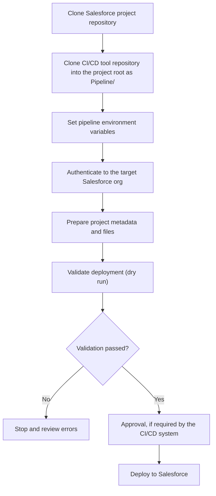

# Salesforce CI/CD

A reusable Python-based CI/CD workflow for Salesforce projects. The workflow keeps Salesforce-specific automation separate from the CI/CD platform that runs it, making the same core process reusable across different CI/CD tools.

## Why this project?

The Salesforce project source code lives in its own repository. The CI/CD workflow is maintained separately and cloned into the project workspace (for example, under `Pipeline/`) by the CI/CD job.

This separation is a key design advantage: the workflow is not tied to a single CI/CD product. Platforms such as Azure DevOps, Jenkins, GitLab CI, or other runners can invoke the same Python commands, while each platform handles checkout, secrets, approvals, and job orchestration.

## Workflow

1. **Checkout the Salesforce project** — Clone the repository containing the Salesforce source code into the runner workspace.
2. **Checkout this CI/CD tool** — Clone this repository into a `Pipeline/` directory under the Salesforce project root.
3. **Provide configuration and secrets** — The CI/CD platform supplies the required environment variables securely. Environment-specific preparation rules are stored in configuration files.
4. **Authenticate** — Authenticate to the target Salesforce org.
5. **Prepare** — Apply the configured file replacements and supported metadata updates.
6. **Validate or deploy** — Validate the prepared source without deploying, or deploy it to the target org.

## CI/CD workflow



## Prerequisites

- Python 3
- Salesforce CLI (`sf`) installed and available in `PATH`
- A Salesforce project repository
- A CI/CD runner with access to both repositories
- Salesforce authentication credentials and the required org permissions

## Configuration

### Authentication

The Salesforce project's `config/config.json` is a standard Salesforce-generated project configuration file. It already contains the `#{auth_url}#` placeholder expected by this workflow; you do not need to add the placeholder manually.

The CI/CD platform should provide `auth_url` as a secret variable. The workflow substitutes the value at runtime before invoking Salesforce CLI authentication. Do not commit a real authentication URL or print it in logs.

### Environment-specific preparation

Set `SF_TARGET_ENV` to select the target environment (for example, `dev`, `test`, or `prod`). The workflow uses the corresponding `before-deploy-{env}.json` configuration.

An example file, `config/before-deploy-dev.json`, is included. Use it as a reference when preparing configuration for other environments, and adjust the rules to match the Salesforce project.

The Salesforce project should also contain the relevant configuration and any files referenced by the preparation rules, including the `filereplacement/` directory when file replacement is configured.

## Commands

Run the commands from the Salesforce project root, with this repository cloned under `Pipeline/`.

### 1. Authenticate

```bash
python Pipeline/cicd.py authenticate
```

Authenticates to Salesforce and records the authenticated target org information for subsequent stages. The workflow targets the selected org explicitly instead of relying on a shared Salesforce CLI default org.

### 2. Prepare

```bash
python Pipeline/cicd.py prepare
```

Applies the preparation rules selected for `SF_TARGET_ENV`, including configured file replacements and supported Salesforce metadata updates. Run this before validation or deployment.

### 3. Validate

```bash
python Pipeline/cicd.py validate
```

Runs a validation-only deployment (dry run) against the target org. It helps identify metadata and test failures without deploying the changes.

### 4. Deploy

```bash
python Pipeline/cicd.py deploy
```

Deploys the prepared source to the authenticated target org. Run it only after the required validation and any approvals required by your organization.

## CI/CD platform responsibilities

The CI/CD platform is responsible for checking out both repositories, installing prerequisites, securely providing environment variables, invoking the commands in the required order, enforcing approvals (especially for production), and handling exit codes.

The Python workflow contains the reusable Salesforce operations. Integrating it with another CI/CD platform should not require rewriting the core Salesforce workflow.

## Project documentation

See [`ARCHITECTURE.md`](ARCHITECTURE.md) for a file-by-file explanation of the Python modules and the Salesforce project configuration files.

## Security notes

- Store authentication credentials in the CI/CD platform's secret store.
- Never commit real authentication URLs or credentials.
- Restrict Salesforce permissions and protect production deployments with pipeline approvals.
- Handle logs, workspaces, and build artifacts according to your organization's security policies.
